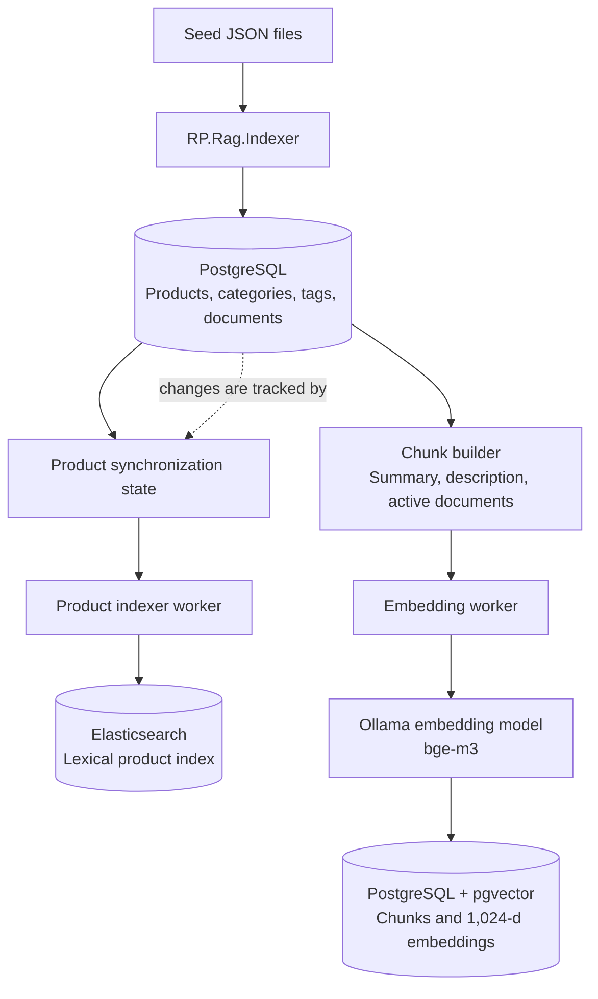
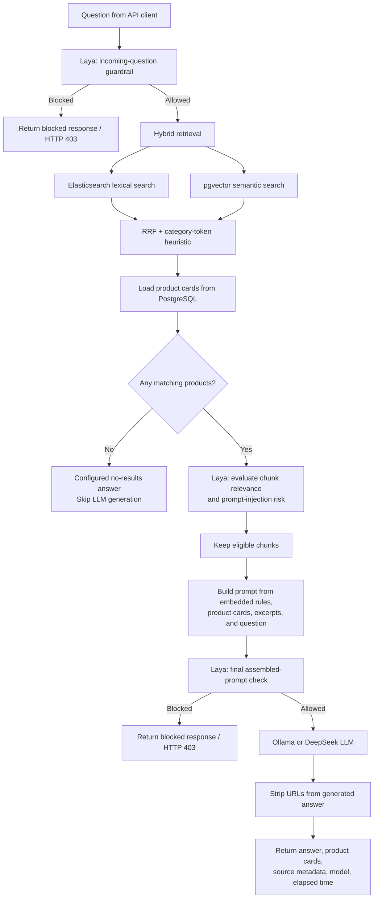

# RP.RAG

**RP.RAG** is a small, end-to-end Retrieval-Augmented Generation (RAG) backend for an online product catalog. It is a learning and reference project for exploring lexical search, vector-based semantic search, hybrid retrieval, grounded LLM answers, and probabilistic guardrails in a .NET application.

The current implementation uses **.NET 10, ASP.NET Core, PostgreSQL + pgvector, Elasticsearch, Ollama, and Laya**. Answer generation can also be configured to use the DeepSeek API.

> **Project status:** This is an experimental learning/reference implementation, not a production-ready search platform. It uses seed/demo catalog data, and deep performance optimization has not been a primary focus. Retrieval quality, LLM output quality, prompt-injection resistance, and operational security must be evaluated for the target catalog and deployment.

## What it demonstrates

- **Lexical retrieval** with Elasticsearch, including English and Persian text analysis.
- **Semantic retrieval** by embedding product content and querying pgvector using cosine distance.
- **Hybrid retrieval** that combines lexical and semantic rankings with Reciprocal Rank Fusion (RRF).
- **Chunk-level retrieval** across product summaries, descriptions, and active product documents such as warranties, return policies, manuals, specifications, and FAQs.
- **Grounded answer generation** using retrieved catalog data and a configurable generation provider.
- **Database-backed product cards and source references:** product facts are loaded from PostgreSQL rather than being invented by the language model.
- **Background indexing and embedding workers** that track changes and retry failed processing.
- **Laya guardrails at three stages:** incoming-question assessment, retrieved-chunk relevance/injection assessment, and a final assembled-prompt check before the LLM call.
- **Separate Markdown policies** for assistant boundaries (`Rules/guardrails.md`) and response presentation (`Rules/response-style.md`).
- **Seed data and labeled search queries** for repeatable local experiments.

## Architecture

### 1. Data loading and indexing



The indexer seeds the relational catalog, processes pending product synchronization records, and maintains the Elasticsearch index and vector embeddings. Product changes are tracked so the workers can process pending work rather than rebuilding every record on every polling cycle.

### 2. Question answering (`POST /api/ask`)



**Important:** RRF combines the lexical and semantic rankings. Laya does **not** re-weight the RRF scores; it classifies retrieved chunks for relevance and possible prompt injection, and the application filters chunks based on those decisions.

## Main components

| Component | Responsibility |
|---|---|
| `RP.Rag.Domain` | Product catalog entities, product documents, chunks, and synchronization state. |
| `RP.Rag.Application` | Search and embedding abstractions, chunk construction, ranking, prompt building, and request/response models. |
| `RP.Rag.Infrastructure` | EF Core/PostgreSQL persistence, pgvector queries, Elasticsearch integration, embedding/generation clients, Laya integrations, and seed loading. |
| `RP.Rag.Indexer` | Background workers that load seed data, synchronize product content to Elasticsearch, and create/update embeddings. |
| `RP.Rag.Api` | HTTP endpoints for lexical, semantic, hybrid search, and RAG-based question answering. |
| `Rules/guardrails.md` | Assistant scope, grounding requirements, untrusted-content boundaries, and policy boundaries. |
| `Rules/response-style.md` | Language, tone, structure, and product-recommendation presentation rules. |

## Retrieval flow

### 1. Lexical search

Elasticsearch indexes searchable product fields such as names, summaries, descriptions, category names, tags, and combined search text. Field boosts and phrase/partial matching help prioritize stronger textual matches.

For Persian text, the index defines a `persian_custom` analyzer on `.fa` multi-fields. It includes zero-width non-joiner handling, digit normalization, Arabic/Persian character normalization, Persian stop words, and conservative plural-suffix removal. Lexical queries can search both the default fields and their Persian sub-fields.

### 2. Semantic search

Product content is split into chunks. The chunk builder creates a summary chunk and chunks for descriptions and active product documents. Longer sections are divided into smaller pieces, and the product name/category are prefixed to the text used for embeddings.

The embedding provider is implemented through Ollama. The default embedding model is `bge-m3`, configured to return **1,024-dimensional** vectors. Vectors are stored in PostgreSQL using pgvector, and `ProductChunks.Embedding` has an HNSW index configured for cosine distance.

Changing the embedding model is not just a configuration switch: its output dimensions must match the database vector column, and existing chunks need to be re-embedded.

### 3. Hybrid search

Hybrid retrieval runs lexical and semantic search and combines their rankings with Reciprocal Rank Fusion (RRF), using `k = 60` by default. A chunk can receive a contribution from its own semantic rank and from the lexical rank of its product. Products found only through lexical search can still contribute a summary or description chunk.

The implementation also contains a category-token index intended to infer a likely category from query terms. Like other ranking heuristics, its effect should be validated against representative queries rather than assumed to improve relevance for every catalog.

### 4. RAG / Ask

The `POST /api/ask` flow is:

1. Run hybrid retrieval to find product IDs and candidate chunks.
3. Load product cards from PostgreSQL.
4. If no products are found, return the configured no-results answer without calling the generation model.
5. Ask Laya for one four-way decision per retrieved chunk: relevant, partially relevant, irrelevant, or prompt injection. By default, only relevant chunks are retained; partially relevant chunks are excluded unless `Ask:IncludePartiallyRelevantChunks` is enabled. Chunks flagged for prompt injection are excluded.
6. Build the user prompt from the product cards, retained excerpts, and question. The system prompt includes the project’s embedded Markdown rules.
7. Make one Laya request that checks both the original question's policy and the assembled prompt. This runs after internal retrieval but before generation.
8. If allowed, send the prompt to the configured answer-generation provider.
9. Strip URL-like strings from the generated answer and return the answer, generation model, elapsed time, product cards, and source metadata.

The answer can refer to products using numbered references such as `[1]`. Product cards are loaded from PostgreSQL, while the source metadata identifies retrieved excerpts associated with those product references.

## Laya guardrails

RP.RAG calls a Laya-compatible service using `POST /v1/systemone`. The configured base URL defaults to `http://localhost:8090`. An optional bearer API key can be configured. For up to 64 retrieved chunks, Ask normally makes two Laya HTTP requests; periodic memory distillation may make one additional request.

### Input policy check

As part of the final check, Laya returns probability estimates for the original question:

- jailbreak attempts;
- prompt injection aimed at the assistant;
- requests outside the product-catalog scope;
- restricted content described by the project policy;
- requests for external websites, URLs, stores, marketplaces, apps, or other external sources.

The application compares these estimates with configured thresholds. If the request is blocked, `/api/ask` returns HTTP `403` without calling the answer-generation model. Retrieval is internal and read-only, so it may already have run.

### Stage 2: retrieved chunks

Laya classifies each retrieved chunk once as `relevant`, `partially_relevant`, `irrelevant`, or `prompt_injection`. Chunks flagged for prompt injection are excluded. This stage is a filter, not a second ranking pass over the RRF scores.

### Stage 3: assembled prompt

After prompt construction, the same Laya request checks the original question's policy and the assembled **untrusted user prompt/context** for jailbreak and prompt-injection signals before the application calls the LLM. If blocked, `/api/ask` returns HTTP `403` and generation is skipped.

### Guardrail Markdown files

The application embeds these files as resources when it builds the `RP.Rag.Application` assembly:

- `Rules/guardrails.md` defines the assistant’s product-catalog scope, evidence and grounding requirements, treatment of user and retrieved content as untrusted data, content boundaries, and enforcement limitations.
- `Rules/response-style.md` defines the language, tone, structure, product-comparison style, and formatting of allowed answers.
- `src/RP.Rag.Application/Prompts/system-prompt.md` defines the base role of the product-catalog assistant.

`PromptBuilder` combines these resources into the system prompt. The application does not re-read these Markdown files from disk for every request; changes require rebuilding/redeploying the application so the embedded resources are updated.

### Security and cost notes

Laya can prevent some blocked requests from reaching the generation model, which may avoid unnecessary generation calls. It also introduces its own service calls and latency, so any overall cost or performance benefit should be measured rather than assumed.

Laya decisions are probabilistic and can produce false positives or false negatives. Prompt rules, URL stripping, and Laya are defense-in-depth measures, **not a hard security boundary**. They do not replace application-enforced authentication, authorization, schema validation, business rules, monitoring, output validation, or adversarial testing. The current implementation checks prompts before generation; it does **not** run a separate Laya check on the generated answer. Generated URLs are stripped as an additional output check.

## Technology stack

- .NET 10 / ASP.NET Core
- Entity Framework Core
- PostgreSQL
- pgvector for vector storage and similarity search
- Elasticsearch for lexical retrieval
- Ollama for local embeddings and, optionally, local answer generation
- DeepSeek API as an alternative answer-generation provider
- Laya-compatible decision API for guardrail assessments
- Scalar for the API reference UI

## Prerequisites

Install or prepare:

- .NET 10 SDK
- Docker with Compose
- Ollama running on the host, unless you configure the embedding service differently
- A Laya-compatible service exposing `POST /v1/systemone`, reachable at the configured `Laya:Url`
- The required Ollama models:

```bash
ollama pull bge-m3
ollama pull gemma4:e4b
```

The current embedding implementation expects 1,024 dimensions. The generation model can be changed through configuration to another compatible Ollama chat model. If you use DeepSeek for generation, Ollama is still used for embeddings in the current implementation.

## Run locally

### 1. Start infrastructure

From the repository root:

```bash
docker compose up -d
```

This starts the PostgreSQL/pgvector and Elasticsearch services defined by the repository's Compose configuration. Check the Compose file and local port mappings if your environment differs. The Laya service is configured separately unless you add it to your own local deployment.

### 2. Configure the services

Review:

- `src/RP.Rag.Api/appsettings.json`
- `src/RP.Rag.Indexer/appsettings.json`

The default local endpoints are:

- PostgreSQL: `localhost:5432`
- Elasticsearch: `http://localhost:9200`
- Ollama: `http://localhost:11434`
- Laya: `http://localhost:8090`

Configure `Generation:Provider` as `Ollama` or `DeepSeek`. For DeepSeek, supply the API key through a development secret or environment variable rather than committing it to source control. If the API runs inside Docker, `localhost` refers to the container itself; configure the correct service name or host address for each dependency.

Do not use the sample database password or other development defaults in production.

### 3. Run the indexer

```bash
dotnet run --project src/RP.Rag.Indexer
```

The indexer seeds the database and runs background workers for Elasticsearch indexing and embedding. Let the initial processing complete before evaluating semantic or hybrid search. The workers poll for pending changes and retry processing failures.

### 4. Run the API

In another terminal:

```bash
dotnet run --project src/RP.Rag.Api
```

In Development, the API is configured to apply database migrations at startup.

Default HTTP URL:

```text
http://localhost:5290
```

Scalar API reference:

```text
http://localhost:5290/scalar/v1
```

Ready-made HTTP requests are included in `src/RP.Rag.Api/RP.Rag.Api.http`.

## API endpoints

| Method | Endpoint | Purpose |
|---|---|---|
| `GET` | `/api/search/lexical?q={query}&topK={count}` | Search Elasticsearch lexical matches. |
| `GET` | `/api/search/semantic?q={query}&topK={count}` | Search using vector similarity. |
| `GET` | `/api/search/hybrid?q={query}&topK={count}` | Combine lexical and semantic retrieval. |
| `POST` | `/api/ask` | Retrieve product context and generate a grounded answer, after guardrail checks. |

The search endpoints require a non-empty `q` query parameter. `topK` is optional and defaults to `10` for search requests. The Ask endpoint accepts a JSON body with `question` and optional `topK` (number of products to retrieve/use by default).

### Example: hybrid search

```bash
curl --get "http://localhost:5290/api/search/hybrid" \
  --data-urlencode "q=best motion sensor for cable-free use" \
  --data-urlencode "topK=10"
```

### Example: ask a product question

```bash
curl -X POST "http://localhost:5290/api/ask" \
  -H "Content-Type: application/json" \
  -d '{
    "question": "What is the return policy for this speaker?",
    "topK": 3
  }'
```

The Ask response includes the original question, answer, generation model, elapsed time, product cards, and source metadata. If a guardrail blocks the request, the endpoint returns HTTP `403` with a blocked response. If no products are found, it returns the configured no-results answer without invoking the LLM. Exact content and response time depend on the indexed data and configured services.

## Configuration reference

The principal settings are in the API and Indexer `appsettings.json` files.

| Setting | Default / example | Notes |
|---|---|---|
| `ConnectionStrings:Postgres` | Local PostgreSQL connection | Database connection used by the application. |
| `Elasticsearch:Url` | `http://localhost:9200` | Elasticsearch endpoint. |
| `Elasticsearch:ProductIndexName` | `products` | Product index name. |
| `Elasticsearch:RequestTimeoutSeconds` | `30` | Elasticsearch request timeout. |
| `Ollama:Url` | `http://localhost:11434` | Ollama endpoint. |
| `Ollama:EmbeddingModel` | `bge-m3:latest` | Embedding model; currently expected to return 1,024 dimensions. |
| `Ollama:GenerationModel` | `gemma4:e4b` | Default local answer-generation model. |
| `Ollama:Temperature` | `0.2` | Generation temperature. |
| `Generation:Provider` | `Ollama` | Select `Ollama` or `DeepSeek` for answer generation. |
| `DeepSeek:Url` | `https://api.deepseek.com` | DeepSeek API base URL. |
| `DeepSeek:ApiKey` | Empty in sample | Supply securely when using DeepSeek. |
| `DeepSeek:GenerationModel` | `deepseek-flash` | Configured generation model identifier. Confirm availability for your account/provider. |
| `Laya:Url` | `http://localhost:8090` | Base URL for the Laya-compatible decision service. RP.RAG posts to `v1/systemone`. |
| `Laya:ApiKey` | Empty in sample | Optional bearer API key for Laya. |
| `Laya:RequestTimeoutSeconds` | `30` | Timeout for Laya requests. |
| `Laya:JailbreakThreshold` | `0.5` | Incoming-question jailbreak threshold. |
| `Laya:PromptInjectionThreshold` | `0.5` | Incoming-question prompt-injection threshold. |
| `Laya:PolicyViolationThreshold` | `0.5` | Threshold for out-of-scope, restricted-content, and external-source decisions. |
| `Laya:ChunkPromptInjectionThreshold` | `0.5` | Threshold for excluding retrieved chunks flagged for prompt injection. |
| `Laya:FinalJailbreakThreshold` | `0.8` | Jailbreak threshold for the assembled prompt/context check. |
| `Laya:FinalPromptInjectionThreshold` | `0.5` | Prompt-injection threshold for the assembled prompt/context check. |
| `Ask:TopProducts` | `5` | Number of products used as answer context by default. |
| `Ask:ChunksPerProduct` | `2` | Maximum retrieved excerpts per product for Ask. |
| `Ask:IncludePartiallyRelevantChunks` | `false` | Whether to retain chunks classified as partially relevant. |
| `Ask:MaxQuestionLength` | `500` | Questions are trimmed to this maximum length after the initial guardrail check. |
| `EmbeddingWorker:PollIntervalSeconds` | `5` | Embedding worker polling interval. |
| `EmbeddingWorker:BatchSize` | `5` | Number of pending product sync rows processed per iteration. |
| `EmbeddingWorker:MaxChunksPerBatch` | `2000` | Upper bound for a batch of chunk texts sent for embedding. |
| `ProductIndexerWorker:PollIntervalSeconds` | `30` | Elasticsearch indexer polling interval. |

The Laya thresholds must be between `0` and `1`. Thresholds should be calibrated using representative safe and adversarial examples instead of being treated as universal defaults. Use environment-specific settings for credentials, endpoints, ports, timeouts, and model choices.

## Persian lexical search

The Elasticsearch index defines Persian multi-fields for product names, summaries, descriptions, category names, and combined search text. The `persian_custom` analyzer includes:

- Handling of the zero-width non-joiner.
- Lowercasing and normalization of Persian/Arabic character variants.
- Conversion of Persian digits to ASCII digits.
- Persian stop-word filtering.
- Conservative removal of `ها` and `های` plural suffixes when enough stem characters remain.

The lexical query searches both the default text fields and Persian `.fa` sub-fields, allowing English and Persian text to coexist in the index. This is lexical normalization, not a claim that Persian semantic embeddings are accurate; evaluate each retrieval strategy separately on Persian-language queries.

When the Elasticsearch mapping changes, the index must be rebuilt and the corresponding products must be marked for synchronization. The indexer uses product synchronization state to skip unchanged records.

Example analyzer inspection:

```bash
curl -X POST "http://localhost:9200/products/_analyze" \
  -H "Content-Type: application/json" \
  -d '{
    "field": "name.fa",
    "text": "نمونه عبارت فارسی"
  }'
```

To force a full rebuild in a disposable local environment, delete the Elasticsearch index and reset the relevant `ProductSyncs` rows so the indexer processes the product content again. Restart the API so the index is recreated, then restart the indexer. Deleting the index removes its indexed documents; do not run this against an environment whose index you need to preserve.

```bash
curl -X DELETE "http://localhost:9200/products"
```

## Seed data and query examples

The repository contains JSON seed-data loaders for categories, tags, products, and product documents. Product documents can represent warranties, return policies, manuals, specifications, and FAQs. The indexer uses synchronization records to track pending indexing and embedding work.

The repository's example query data covers:

- **Lexical:** direct keywords, tags, and product names.
- **Semantic:** intent-oriented phrasing that may not repeat the catalog's exact tags.
- **Hybrid:** a concrete product term plus a semantic constraint.
- **Ask/RAG:** document lookup or synthesis across multiple products.

Expected product IDs in labeled query data should be treated as evaluation targets, not as a guarantee that every model or configuration will return identical rankings.

## Evaluating retrieval and guardrails

Evaluate retrieval quality separately from final answer quality and guardrail behavior.

1. Run a stable set of representative lexical, semantic, and hybrid queries.
2. Compare returned product IDs with labeled relevant product IDs in the seed query data.
3. Track metrics such as Precision@K, Recall@K, and Mean Reciprocal Rank (MRR) if your evaluation tooling supports them.
4. Test questions whose answers are present in warranty, manual, and return-policy documents.
5. Test missing-information questions and verify the assistant acknowledges when the catalog context does not contain an answer.
6. Test safe questions alongside direct and indirect prompt-injection attempts in both questions and retrieved product documents.
7. Measure false positives and false negatives at each Laya stage and calibrate thresholds against your evaluation set.
8. Repeat tests after changing analyzers, embedding models, chunking, ranking heuristics, Laya thresholds, or prompt rules.

A relevant product appearing somewhere in the results is not enough by itself: ranking, the selected source chunks, the final answer, and guardrail decisions all matter.

## Change tracking and reprocessing

`ProductSyncInterceptor` detects changes to relevant product data, tags, and documents, then marks products for re-indexing and re-embedding. Workers use synchronization state to process pending work rather than rebuilding every product on every poll.

If you change the Elasticsearch mapping or embedding model, ordinary change tracking may not be sufficient. Follow a deliberate reindex/re-embedding procedure and verify that the model name, vector dimensions, and stored embeddings remain consistent.

## EF Core migrations

The project uses EF Core migrations from the Infrastructure project. Typical commands are:

```bash
dotnet ef migrations add <MigrationName> \
  --project src/RP.Rag.Infrastructure \
  --startup-project src/RP.Rag.Api \
  --output-dir Data/Migrations
```

```bash
dotnet ef database update \
  --project src/RP.Rag.Infrastructure \
  --startup-project src/RP.Rag.Api
```

Review generated migrations before applying them to any database containing data you need to preserve.

## Project layout

```text
.
├── Rules/
│   ├── guardrails.md
│   ├── response-style.md
│   └── README.fa.md
├── data/
│   └── seed/
├── docs/
├── src/
│   ├── RP.Rag.Domain/
│   │   └── Entities/
│   ├── RP.Rag.Application/
│   │   ├── Ask/
│   │   ├── Catalog/
│   │   ├── Embeddings/
│   │   ├── Prompts/
│   │   └── Search/
│   ├── RP.Rag.Infrastructure/
│   │   ├── Ask/
│   │   ├── Catalog/
│   │   ├── Data/
│   │   ├── Elastic/
│   │   ├── Embeddings/
│   │   ├── Search/
│   │   └── SeedData/
│   ├── RP.Rag.Indexer/
│   │   └── Workers/
│   └── RP.Rag.Api/
│       └── Controllers/
├── tests/
├── RP.RAG.slnx
├── docker-compose.yml
└── README.md
```

## Current limitations and roadmap

### Current limitations

- **Experimental data and limited optimization:** the seed catalog is for local experiments; deep performance tuning has not been the focus.
- **Retrieval is not automatically accurate:** quality depends on catalog content, analyzer configuration, embeddings, chunking, ranking, and evaluation.
- **Dimension-specific embeddings:** the current vector column is `vector(1024)`.
- **Probabilistic guardrails:** Laya may miss attacks or incorrectly flag safe requests. The current implementation does not perform a separate Laya review of the generated answer.
- **LLM output can still be wrong:** grounding and source references reduce risk but do not guarantee factual correctness. Validate critical fields against the database.
- **No persistent memory or general-purpose agent tools:** the current assistant does not store user preferences across conversations, perform autonomous multi-step tasks, or expose an MCP server.
- **Provider privacy and cost differ:** Ollama supports local inference; DeepSeek generation sends prompts to an external service and has different privacy, availability, and cost implications.
- **Production hardening is still required:** authentication/authorization, rate limiting, monitoring, robust error handling, backups, resource limits, and adversarial testing need to be addressed for a real deployment.
- **Credentials must be protected:** do not commit API keys or production passwords.

### Planned direction

The intended next steps are exploratory and are not implemented features in the current version:

1. Add **Memory** for retaining and retrieving relevant information across interactions.
2. Evolve the RAG workflow into an **AI Agent** capable of managing tasks within explicitly defined boundaries.
3. Expose selected capabilities through an **MCP Server** so other compatible AI agents can use them.

## License

See [`LICENSE`](LICENSE).
